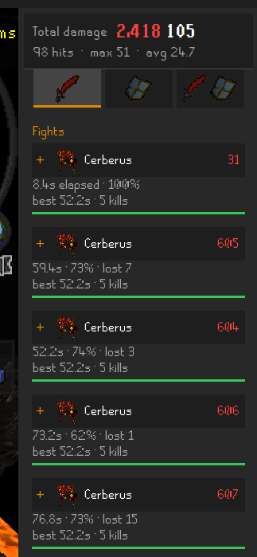
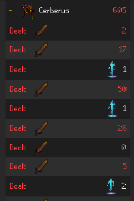
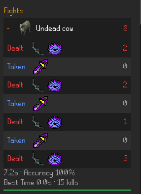

# Detailed Combat Log

Sidebar log of hits you deal and hits you take. One NPC stays one fight until it dies or despawns, so a pause in the middle does not start a second log.

The sidebar icon is the Arkan blade.

## Examples

A few Cerberus kills, collapsed. The header is the session total. Each fight has its time, accuracy, and any ticks you dropped past your weapon speed. Best time for that monster is repeated under the fight.



Same kind of fight, opened. Dealt rows use the weapon that actually swung and the offensive prayer that was on. Thrall hits use the thrall, in white, instead of your weapon. Newest hit is at the top.



Both view on an undead cow: red for damage dealt, blue for damage taken. A 0 on a taken row is a block. The footer is the fight length and your accuracy. Specs show up in gold as one summed hit.



## What it keeps

Your hitsplats, including the tinted ones (cyan, yellow, orange, white, poise) and max hits. Max hits are marked `(Max hit)` next to the number.

Damage you take is logged too, including poison, venom, burn, and bleed. Other players' hits on your target are not.

Blocks are kept by default and do not add to the damage total. A magic splash is logged as a 0 when the attack was magic. Accuracy is your weapon hits divided by weapon hits plus blocks and splashes. Thralls and other effects stay out of that percentage.

Multi-hit weapons and specs are one row per swing, with the splats added together. A spec is labeled Spec.

The three icons under the totals switch the list between outgoing, incoming, and both. The overlay uses the same view. On the overlay the accuracy label is shortened to Acc so the line fits.

Clear asks you to confirm. Copy puts the log on the clipboard, oldest hit first. Turning the plugin off hides it and keeps the hits. Clear on logout wipes the log at the login screen. A world hop keeps it.

## Run it

JDK 11 or newer.

```sh
./gradlew run
```

That starts a dev client with the plugin loaded. Jagex account login is covered at <https://github.com/runelite/runelite/wiki/Using-Jagex-Accounts>.

To drop the jar into another developer-mode client:

```sh
./gradlew jar
mkdir -p ~/.runelite/sideloaded-plugins
cp build/libs/combat-log-1.0.0.jar ~/.runelite/sideloaded-plugins/
```

Use `combat-log-1.0.0.jar`, not the larger `-all` jar, and start that client with `--developer-mode`.

## Settings

| Setting | Default | |
| --- | --- | --- |
| Record blocks | On | Keep 0-damage blocks. Totals ignore them either way. |
| Record player hits | On | Also log hits you land on other players. |
| Log length | 300 | Drop the oldest rows after this. |
| Clear on logout | Off | World hops keep the log. |
| Damage view | Outgoing | Outgoing, incoming, or both. The sidebar icons change this too. |
| Show overlay | On | Recent hits on the game view. |
| Overlay rows | 6 | How many hits the overlay lists. |
| Overlay width | 140px | From 120 to 400. |

## Tests

```sh
./gradlew test
```

They check which hitsplats are kept, fight grouping, accuracy, and the copied log. They do not start the client.
